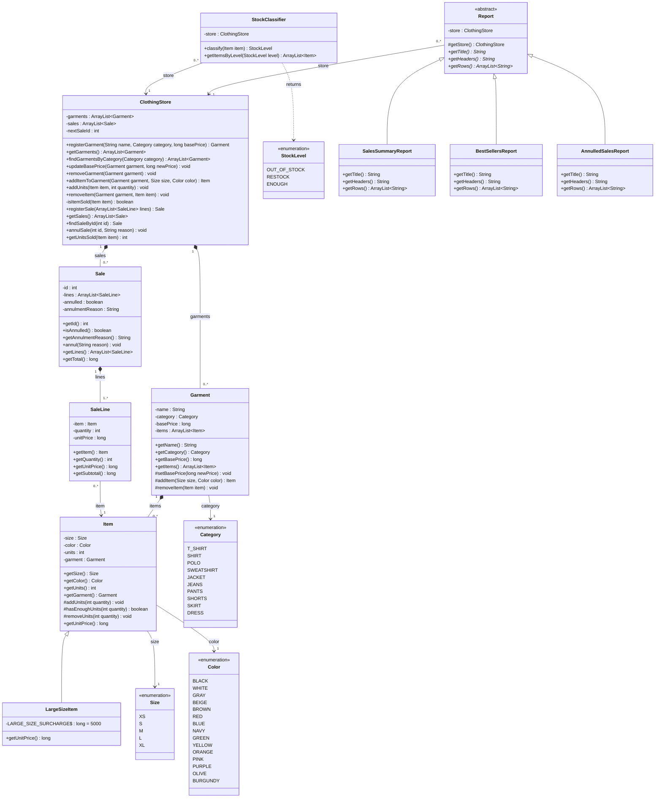

# POO Final Project

> Pendiente: título, integrante (nombre y código), descripción, instrucciones de ejecución, ejemplo de entrada/salida, entidades con CRUD y restricciones.

## Diagrama de clases

> En construcción: por ahora solo la estructura (clases, relaciones y multiplicidades). Los atributos y métodos se agregan en las siguientes fases.

