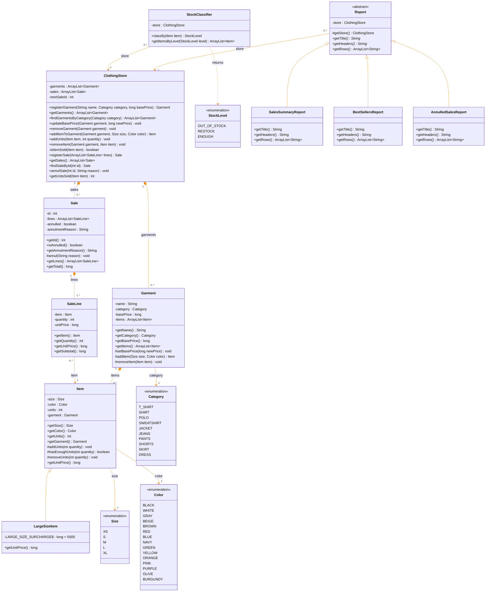

# Sistema de gestión para una tienda de ropa

**Proyecto final – Programación Orientada a Objetos (2026)**

## Integrante

| Nombre | Código |
|---|---|
| Luis Álvaro Velásquez Rodríguez | 18042 |

## Descripción

Aplicación de consola en Java para el personal de una tienda de ropa. Permite
administrar las prendas y su inventario por talla y color, registrar ventas de
varios artículos, anular ventas conservando el registro, consultar reportes y
recibir recomendaciones de reabastecimiento.

- Cada **prenda** (por ejemplo, "Oversize Shirt") tiene nombre, categoría y precio base.
- Cada prenda tiene **artículos**: una combinación de talla y color con sus propias unidades.
  Las tallas L y XL cuestan 5000 más (clase `LargeSizeItem`).
- Una **venta** tiene una o más líneas; cada línea guarda el precio del momento de la venta.
- Los datos se guardan en un archivo (serialización) y los reportes se exportan a CSV.

## Instrucciones de ejecución

**Requisito:** Java 25 (JDK 25 LTS).

### Desde Visual Studio Code

1. Abrir la carpeta del proyecto.
2. Abrir `src/ui/Main.java` y pulsar **Run**.

### Desde la consola

Desde la carpeta raíz del proyecto:

```text
javac -d bin src/domain/*.java src/data/*.java src/ui/*.java
java -cp bin ui.Main
```

### Archivos que genera el programa

- `tienda.dat`: los datos guardados. Se carga al iniciar y se guarda con la opción 4 y al salir.
- `exports/`: los reportes exportados a CSV.

## Ejemplo de entrada/salida

Registrar una prenda con un artículo y unidades:

```text
--- Prendas e inventario ---
Opción: 1
Nombre: Oversize Shirt
1. T_SHIRT
2. SHIRT
...
Elija una categoría: 2
Precio base: 40000
Prenda registrada: Oversize Shirt

Opción: 6
1. Oversize Shirt (SHIRT) - $40000
Elija una prenda: 1
Elija una talla: 5
Elija un color: 1
Artículo agregado: XL BLACK
¿Agregar unidades ahora? (s/n): s
Unidades: 2
Unidades agregadas.
```

Registrar una venta de dos artículos:

```text
--- Ventas ---
Opción: 1
Elija una prenda: 1
1. M BLACK - 5 unidades - $40000
2. XL BLACK - 2 unidades - $45000
Elija un artículo: 1
Cantidad: 2
¿Agregar otro artículo? (s/n): s
Elija una prenda: 1
Elija un artículo: 2
Cantidad: 1
¿Agregar otro artículo? (s/n): n
Venta registrada: #1
- Oversize Shirt M BLACK: 2 x $40000 = $80000
- Oversize Shirt XL BLACK: 1 x $45000 = $45000
Total: $125000
```

Una venta sin unidades suficientes se rechaza completa:

```text
Error: Operación fallida: Oversize Shirt
Talla: M
Color: BLACK
No tiene suficientes unidades en stock (3)
```

Reporte de resumen de ventas:

```text
Resumen de ventas
ID,lineas,unidades,total
1,2,3,125000
TOTAL,2,3,125000
```

## Entidades con CRUD y restricciones

| Entidad | Crear | Consultar | Modificar | Eliminar |
|---|---|---|---|---|
| Prenda (`Garment`) | Sí: nombre, categoría y precio base | Listar, buscar por categoría, ver sus artículos | Solo el precio base | Solo si ninguno de sus artículos tiene ventas |
| Artículo (`Item`) | Sí: talla y color dentro de una prenda | Ver los artículos de una prenda | Solo agregar unidades | Solo si ninguna venta lo referencia |
| Venta (`Sale`) | Sí: una o más líneas | Listar y ver el detalle por número | No: se anula | No: se anula |

### Restricciones

- **Prenda:** el nombre no puede estar vacío y el precio debe ser mayor que cero.
  El nombre y la categoría no cambian después de creada.
- **Artículo:** no se repite una misma combinación de talla y color en una prenda.
  Nace con 0 unidades; las unidades solo **suben** con "agregar unidades" (cantidad mayor que cero)
  y solo **bajan** con una venta. La talla y el color no cambian.
- **Venta:** se registra completa o no se registra. Se rechaza si un artículo se repite
  o si alguno no tiene unidades suficientes; en ese caso no se descuenta nada.
  Cada línea guarda el precio del momento, así que cambiar el precio después no altera la venta.
- **Eliminación:** se cuentan también las ventas anuladas, para que ninguna venta quede
  apuntando a un artículo inexistente.

### Alternativa cuando una operación no corresponde

Las ventas son registros históricos: no se modifican ni se eliminan. En su lugar se **anulan**:

- Una venta se anula una sola vez, con un motivo obligatorio (sin comas, porque se exporta a CSV).
- Al anularla, sus unidades vuelven al inventario.
- La venta anulada se conserva: no cuenta en el resumen ni en los más vendidos,
  y aparece en el reporte de ventas anuladas con su motivo.

## Diagrama de clases

Clases del dominio con sus atributos, métodos, relaciones y multiplicidades.
Visibilidad: `+` pública, `-` privada, `#` protegida (paquete `domain`).


